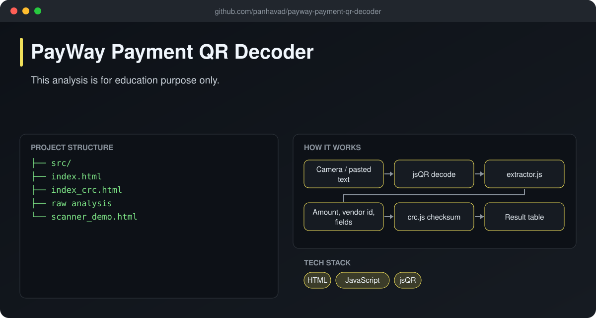
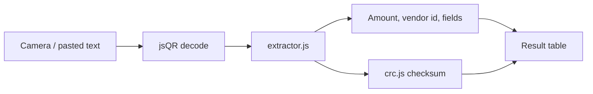

# PayWay Payment QR Decoder

  [](https://github.com/panhavad/payway-payment-qr-decoder/releases/latest)

An **educational analysis of PayWay (ABA) payment QR codes** in Cambodia. Scan or paste a QR payload and the page breaks it into its fields - amount, merchant / vendor ID and more - and checks the **CRC** checksum. For learning only.



## Features

- Camera QR scanning with jsQR
- Field-by-field payload extraction
- CRC calculator to validate payloads
- Runs fully in the browser

## How it works



## Getting started

Open `index.html` (decoder), `scanner_demo.html` (camera) or `index_crc.html` (CRC tool) in a browser.

## Download

Grab the packaged source from the [latest release](https://github.com/panhavad/payway-payment-qr-decoder/releases/latest).

## Tech stack

- HTML
- JavaScript
- jsQR

## Project structure

```text
payway-payment-qr-decoder/
├── docs/
├── src/
├── index.html
├── index_crc.html
├── raw analysis
├── README.md
└── scanner_demo.html
```
